# pixelfx-idea

Original pixel magic effects made with [pixelfx](https://github.com/patch-gg/pixelfx).

## Prism Nova (`arcane/prism-nova`)

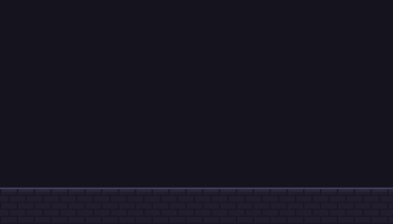

A crystal prism forms in the air, catches a shaft of light and rakes a rainbow fan across the floor,
then overloads, cracks and bursts into spectral shards. One-shot, 2.9 s, 30 fps, 280 x 160 px.

- `effects/arcane/prism-nova.js`: the effect source. Copy it to `src/fx/arcane/` in a pixelfx checkout.
- `renders/prism-nova/prism-nova.png` + `.json`: sprite sheet (88 frames, 8 columns, Aseprite-style JSON).
  Pivot `[112, 134]` (the floor under the prism), 30 fps, no loop. Use nearest filtering.
- `renders/prism-nova/contact.png`: frames at a glance.

Options: `palette` (crystal ramp, dark to bright), `spectrum` (the 7 rainbow colors), `seed`.

```sh
node tools/render.mjs arcane/prism-nova --gif
node tools/render.mjs arcane/prism-nova --sheet --opts '{"spectrum":["#ff2a6a","#ff6ad0","#c06aff","#7a6aff","#4aa0ff","#4affe0","#ffffff"]}'
```

## Inferno Rise (`transitions/inferno-rise`)

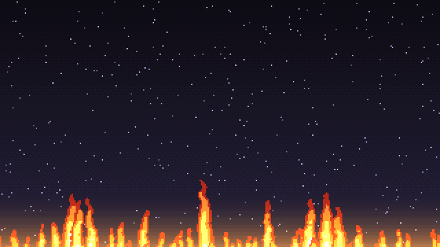

A screen transition. A roaring wall of flame climbs the screen from the bottom, leaving black char.
The char smoulders with glowing cracks, then crumbles away from the top down in falling ash and
the picture returns. One-shot, 3.4 s, 30 fps, 320 x 180 (full screen).

The screen is fully covered from about 1.1 s to 1.7 s, so swap your scene in that window.

- `effects/transitions/inferno-rise.js`: copy to `src/fx/transitions/` in a pixelfx checkout
  (it uses that folder's `_lib.js`).
- `renders/inferno-rise/inferno-rise.png` + `.json`: sprite sheet, 103 frames, transparent where the
  picture shows through. Pivot `[0, 0]` (top-left), 30 fps, no loop.

Options: `palette` (fire ramp, dark to bright), `color` (the cover, default near-black), `seed`.

## Tarot Draw (`arcane/tarot-draw`): all 22 Major Arcana

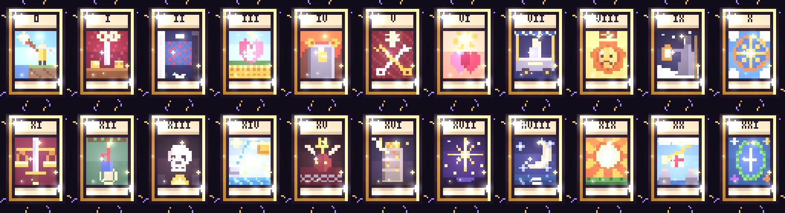

| The Sun (XIX) | The Moon (XVIII) | The Star (XVII) |
|---|---|---|
| 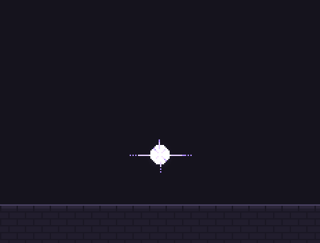 | 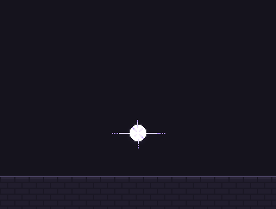 | 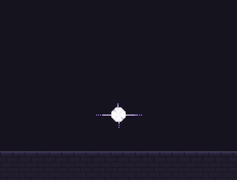 |

Seven tarot cards fan out and spin round in a tilted ring, backs to us, over a rune ring on the floor.
The ring slows, one card floats up and grows while the rest pop into motes, and it flips to reveal its
face in a burst of light, glows, then dissolves upward. One-shot, 3.7 s, 30 fps, 232 x 176 px,
pivot `[116, 148]` (the floor under the ring).

Pick the card with the `card` option:

| | | | | | |
|---|---|---|---|---|---|
| 0 `fool` | I `magician` | II `priestess` | III `empress` | IV `emperor` | V `hierophant` |
| VI `lovers` | VII `chariot` | VIII `strength` | IX `hermit` | X `wheel` | XI `justice` |
| XII `hanged` | XIII `death` | XIV `temperance` | XV `devil` | XVI `tower` | XVII `star` |
| XVIII `moon` | XIX `sun` | XX `judgement` | XXI `world` | | |

- `effects/arcane/tarot-draw.js`: the effect. `effects/arcane/_tarot.js`: the 22 card faces.
  Copy both to `src/fx/arcane/` in a pixelfx checkout.
- `renders/tarot-<card>/`: a sprite sheet + JSON, contact sheet and GIF for every card.

```sh
node tools/render.mjs arcane/tarot-draw --opts '{"card":"tower"}' --gif --sheet
```

**Adding more cards:** each face in `_tarot.js` is a small function that returns a colour for each cell
of the card's picture area (x 3..18, y 9..26 on a 22 x 34 card). Add one and its numeral to `NUM`.
Other options: `palette` (the card back and magic, dark to bright), `gold` (the frames), `seed`.

## Blight Seed (`nature/blight-seed`)

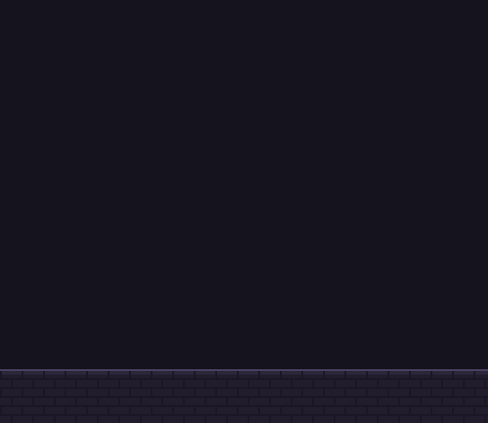

A trap spell in six beats, 9.2 s:

1. **Rune (0–1.15 s):** a green rune circle draws itself in the sky, runes lighting one by one.
2. **Seed (1.15–1.9 s):** it flashes and drops a glowing seed that lands with a pulse; a trap mark glows on the floor.
3. **Growth (1.9–4.2 s):** a sprout unfurls, then grows into a full leafy tree.
4. **Blight (4.4–5.9 s):** poison mist creeps in, the leaves wither to purple, the bark rots and cracks glow green.
5. **Awakening (5.9–7.3 s):** eyes burn open, a fanged maw tears open, boughs swing out and curl into claws,
   roots rip up out of the floor, and it roars (6.85 s) in a blast of mist.
6. **Menace and sink (7.3–9.2 s):** it sways and writhes, then sinks away into the mist and is gone.

One-shot, 30 fps, 272 x 236 px, pivot `[136, 206]` (the floor where the seed lands).

- `effects/nature/blight-seed.js`: copy to `src/fx/nature/` in a pixelfx checkout (it uses that folder's `_lib.js`
  and `arcane/_lib.js`).
- `renders/blight-seed/`: sprite sheet (277 frames) + JSON, contact sheet, GIF.

Options: `palette` (the poison magic), `leaf`, `blight` (withered leaves), `bark`, `rot` (rotten bark), `seed`.

## Blood Moon (`shadow/blood-moon`): werewolf power-up skill

| Silver moon | Yellow moon |
|---|---|
| 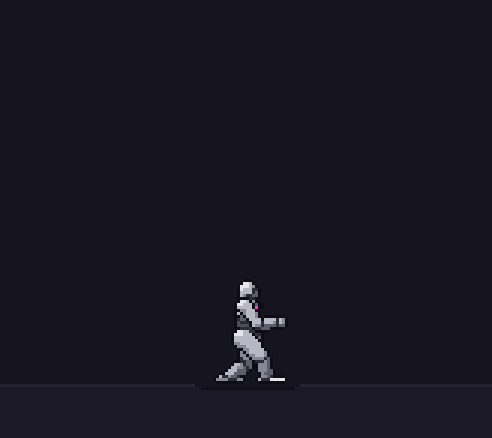 |  |

A skill effect on the character. A small moon rises over his head and trembles; a red tide sweeps across it
behind a burning copper edge while he braces. At **1.12 s** it pulses (a white-hot rim, a shock ring, a hit-stop
and shake) as he throws his head back and arms out in a howl and flashes red. Red light pours down from the moon
into him, he burns with a crimson rim light and aura with embers rising off him, the moon beats twice like a
heart (1.5 s, 1.68 s), then shrinks down into his head (2.05–2.5 s) and the aura fades. One-shot, 3.1 s, 30 fps.

Pick the moon with the `moon` option: `"silver"` (default), `"yellow"`, or your own ramp of 5 colours.
`palette` is the crimson ramp.

- `effects/shadow/blood-moon.js`: copy to `src/fx/shadow/` in a pixelfx checkout (it uses `ui/_lib.js`).
  It reads the character from `o.actor` and has an `act` (brace, howl on the pulse, recover) for your own
  character's animation timing.
- `renders/blood-moon-skill-<silver|yellow>/`: the whole act, character included, as a transparent sprite
  sheet (104 frames of 164 x 146, pivot `[82, 128]` = the feet) + JSON, and a GIF.

## Gacha UR (`ui/gacha-ur`)

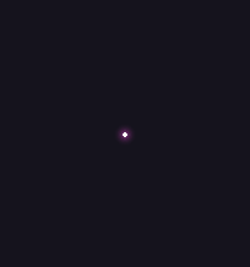

A gacha pull that lands an Ultra Rare card in the **candy** palette. 4.4 s, 30 fps, 208 x 222 px.

1. **Summon (0–0.45 s):** candy-coloured streaks rush into a glowing point.
2. **The card (0.45–0.75 s):** a mystery card pops out of a white flash, its back marked with a `?`.
3. **Rarity climb (0.75–1.9 s):** it shakes harder and harder as its aura climbs **white** (1.05 s),
   **gold** (1.4 s), then cracks into a cycling **candy rainbow**, sparks pulled in faster at each step.
4. **Burst and flip (1.9–2.2 s):** a white flash, a candy flare and rings, and the card flips over and pops.
5. **Reveal (2.2–3.75 s):** the UR card: a holographic candy-striped frame, a rainbow candy star, a `UR`
   badge and five candy rarity stars. **UR** drops in above it with a bounce, candy beams of light turn
   behind it, candy confetti rains, and a shine sweeps across the card twice.
6. **Out (3.75–4.4 s):** it shrinks away into a sparkle.

- `effects/ui/gacha-ur.js` + `effects/ui/_gacha.js` (the shared cards): copy both to `src/fx/ui/` in a pixelfx
  checkout (it also uses that folder's `_lib.js`).
- `renders/gacha-ur/`: sprite sheet (133 frames) + JSON, contact sheet, GIF. Pivot `[104, 118]` (just below the card's centre).

Options: `palette` (the rainbow, default `candy`; try `neon` or your own 7 colours), `text` (default `UR`), `seed`.

## Gacha Star Rain (`ui/gacha-star-rain`): ten-pull scenes

| 9 N + 1 R | 9 R + 1 SR |
|---|---|
|  |  |
| **9 SR + 1 SSR** | **4 N, 1 R, 1 SR, 3 SSR, 1 UR** |
|  |  |

A full-screen (320 x 180) ten-pull, 10.4 s, one-shot, ends empty.

1. **Sky (0–0.6 s):** a night sky fades in with ten empty result slots (a 5 x 2 grid).
2. **Star rain (from 0.75 s):** ten shooting stars fall one after another from the upper right and land in
   their slots, each in the light of its rarity. Rarer stars wait a beat before they come, fall slower with
   longer, wider trails, and land harder. Gold stars turn rays of light. The candy star has a rainbow trail,
   whites out the screen when it lands and throws rainbow rings. When the best star (purple or better)
   lands, the whole sky glows in its colour.
3. **Stars become cards (about 0.8 s after the last star lands):** one by one, each star flares and a card
   pops out of it in a white flash that cools into its face:

   | Star | Card | Rarity stars |
   |---|---|---|
   | White | **N** (silver frame) | 1 |
   | Blue | **R** (blue frame) | 2 |
   | Purple | **SR** (purple frame) | 3 |
   | Gold | **SSR** (gold frame), rays turning behind it, a shine sweeping across | 4 |
   | Candy | **UR**: the same candy holographic card as Gacha UR, candy rays, a shimmering frame | 5 |

4. **Results (until 8.6 s or later):** the cards hold, then each shrinks away into sparkles and the sky fades out.

The pull is the `stars` option, one letter per slot, left to right, top row first:
`W` white (N), `B` blue (R), `P` purple (SR), `G` gold (SSR), `C` candy (UR). The four scenes above are:

| Scene | `stars` |
|---|---|
| 1 | `WWWWWWBWWW` |
| 2 | `BBBBBBBPBB` |
| 3 | `PPPPPPGPPP` |
| 4 | `WGWBWGPWGC` |

- `effects/ui/gacha-star-rain.js` + `effects/ui/_gacha.js` (the shared cards): copy both to `src/fx/ui/`
  in a pixelfx checkout (it also uses `weather/_lib.js`).
- `renders/star-rain-<scene>/`: sprite sheet (313 frames) + JSON, contact sheet, GIF for each scene.

```sh
node tools/render.mjs ui/gacha-star-rain --opts '{"stars":"WGWBWGPWGC"}' --gif --sheet
```

## Matcha Pour (`water/matcha-pour`): background scene

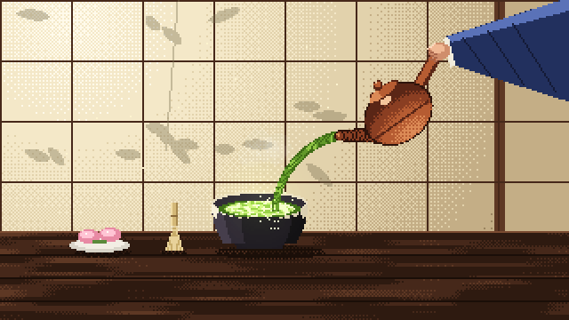

A quiet full-screen (320 x 180) background, a seamless 6 s loop. Sun comes through shoji screens with
bamboo-leaf shadows swaying on the paper and dust turning in the light. On a dark wooden table, a hand in an
indigo kimono sleeve tilts a red clay kyusu and pours a bright rope of matcha into a dark raku bowl with a
cream glaze drip. Light runs down the stream as it wobbles; it splashes and sends ripples across the frothy
surface, and steam curls up. A bamboo chasen and a plate of pink sakura wagashi sit beside it.

- `effects/water/matcha-pour.js`: copy to `src/fx/water/` in a pixelfx checkout (it uses `weather/_lib.js`).
- `renders/matcha-pour/`: sprite sheet (180 frames) + JSON, contact sheet, GIF. Pivot `[160, 180]` (bottom centre).

Options: `palette` (the matcha, deep to froth), `clay` (the teapot), `sleeve` (the kimono), `seed`.
For hojicha, try a brown `palette`; for a black iron pot, a grey `clay`.

## Dragon Hatch (`spawn/dragon-hatch`)

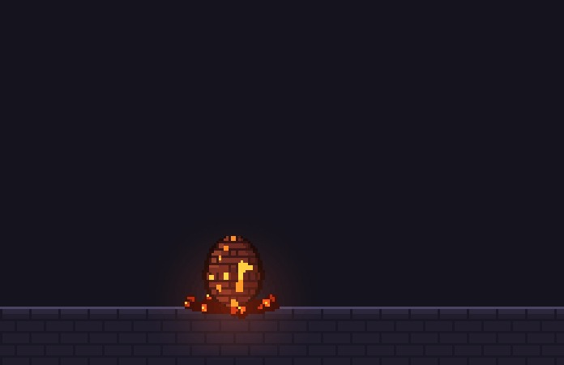

A fire dragon egg hatching. One-shot, 8.4 s, 30 fps, 232 x 150 px, ends empty.

1. **The egg (0–2.3 s):** a dark scaled egg on a nest of breathing embers, lava seams pulsing in its shell.
   It rocks in four bursts, each harder than the last (0.5, 1.1, 1.55, 1.95 s), throwing sparks.
2. **Cracks (2.35 s, 2.75 s):** white-hot cracks race round it, left then right, light bursting through the seams.
3. **Burst (3.2 s):** the top bursts off in a flare, sparks, smoke and shell chips; it tumbles, bounces and
   lies on the nest. The broken rim glows.
4. **Peek (3.4 s):** a baby fire dragon pops its head up, blinks, and looks behind it.
5. **Climb and hop (4.15–5.0 s):** it scrambles up onto the rim, then hops down to the ground with a puff of dust.
6. **Fire (5.3–6.4 s):** it rears back and breathes in, sparks drawn into its mouth, then puffs a little jet
   of fire, then coughs a puff of smoke.
7. **Off it goes (6.85–8.4 s):** a happy hop with sparkles, then it flaps its tiny wings and flutters away up
   and to the right, trailing embers, while the nest cools.

- `effects/spawn/dragon-hatch.js` + `effects/spawn/_dragon.js` (the dragon's pixel sprites: sitting,
  blinking, mouth open, wings down and up): copy both to `src/fx/spawn/` in a pixelfx checkout
  (it uses `weather/_lib.js`).
- `renders/dragon-hatch/`: sprite sheet (253 frames) + JSON, contact sheet, GIF. Pivot `[96, 126]` (the egg's base).

Options: `palette` (the fire, dark to white-hot), `shell` (the egg, dark to light), `seed`.
