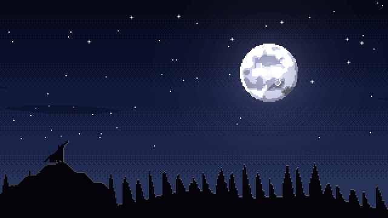
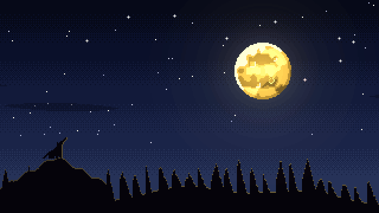

# pixelfx-idea

Original pixel magic effects made with [pixelfx](https://github.com/patch-gg/pixelfx).

## Prism Nova (`arcane/prism-nova`)


A crystal prism forms in the air, catches a shaft of light and rakes a rainbow fan across the floor,
then overloads, cracks and bursts into spectral shards. One-shot, 2.9 s, 30 fps, 280 x 160 px.

- `effects/arcane/prism-nova.js`: the effect source. Copy it to `src/fx/arcane/` in a pixelfx checkout.
- `renders/prism-nova/prism-nova.png` + `.json`: sprite sheet (88 frames, 8 columns, Aseprite-style JSON).
  Pivot `[112, 134]` (the floor under the prism), 30 fps, no loop. Use nearest filtering.
- `renders/prism-nova/contact.png`: frames at a glance.

Options: `palette` (crystal ramp, dark to bright), `spectrum` (the 7 rainbow colors), `seed`.

```sh
node tools/render.mjs arcane/prism-nova --gif
node tools/render.mjs arcane/prism-nova --sheet --opts '{"spectrum":["#ff2a6a","#ff6ad0","#c06aff","#7a6aff","#4aa0ff","#4affe0","#ffffff"]}'
```

## Inferno Rise (`transitions/inferno-rise`)


A screen transition. A roaring wall of flame climbs the screen from the bottom, leaving black char.
The char smoulders with glowing cracks, then crumbles away from the top down in falling ash and
the picture returns. One-shot, 3.4 s, 30 fps, 320 x 180 (full screen).

The screen is fully covered from about 1.1 s to 1.7 s, so swap your scene in that window.

- `effects/transitions/inferno-rise.js`: copy to `src/fx/transitions/` in a pixelfx checkout
  (it uses that folder's `_lib.js`).
- `renders/inferno-rise/inferno-rise.png` + `.json`: sprite sheet, 103 frames, transparent where the
  picture shows through. Pivot `[0, 0]` (top-left), 30 fps, no loop.

Options: `palette` (fire ramp, dark to bright), `color` (the cover, default near-black), `seed`.

## Tarot Draw (`arcane/tarot-draw`): all 22 Major Arcana


| The Sun (XIX) | The Moon (XVIII) | The Star (XVII) |
|---|---|---|
|  |  |  |

Seven tarot cards fan out and spin round in a tilted ring, backs to us, over a rune ring on the floor.
The ring slows, one card floats up and grows while the rest pop into motes, and it flips to reveal its
face in a burst of light, glows, then dissolves upward. One-shot, 3.7 s, 30 fps, 232 x 176 px,
pivot `[116, 148]` (the floor under the ring).

Pick the card with the `card` option:

| | | | | | |
|---|---|---|---|---|---|
| 0 `fool` | I `magician` | II `priestess` | III `empress` | IV `emperor` | V `hierophant` |
| VI `lovers` | VII `chariot` | VIII `strength` | IX `hermit` | X `wheel` | XI `justice` |
| XII `hanged` | XIII `death` | XIV `temperance` | XV `devil` | XVI `tower` | XVII `star` |
| XVIII `moon` | XIX `sun` | XX `judgement` | XXI `world` | | |

- `effects/arcane/tarot-draw.js`: the effect. `effects/arcane/_tarot.js`: the 22 card faces.
  Copy both to `src/fx/arcane/` in a pixelfx checkout.
- `renders/tarot-<card>/`: a sprite sheet + JSON, contact sheet and GIF for every card.

```sh
node tools/render.mjs arcane/tarot-draw --opts '{"card":"tower"}' --gif --sheet
```

**Adding more cards:** each face in `_tarot.js` is a small function that returns a colour for each cell
of the card's picture area (x 3..18, y 9..26 on a 22 x 34 card). Add one and its numeral to `NUM`.
Other options: `palette` (the card back and magic, dark to bright), `gold` (the frames), `seed`.

## Blight Seed (`nature/blight-seed`)


A trap spell in six beats, 9.2 s:

1. **Rune (0–1.15 s):** a green rune circle draws itself in the sky, runes lighting one by one.
2. **Seed (1.15–1.9 s):** it flashes and drops a glowing seed that lands with a pulse; a trap mark glows on the floor.
3. **Growth (1.9–4.2 s):** a sprout unfurls, then grows into a full leafy tree.
4. **Blight (4.4–5.9 s):** poison mist creeps in, the leaves wither to purple, the bark rots and cracks glow green.
5. **Awakening (5.9–7.3 s):** eyes burn open, a fanged maw tears open, boughs swing out and curl into claws,
   roots rip up out of the floor, and it roars (6.85 s) in a blast of mist.
6. **Menace and sink (7.3–9.2 s):** it sways and writhes, then sinks away into the mist and is gone.

One-shot, 30 fps, 272 x 236 px, pivot `[136, 206]` (the floor where the seed lands).

- `effects/nature/blight-seed.js`: copy to `src/fx/nature/` in a pixelfx checkout (it uses that folder's `_lib.js`
  and `arcane/_lib.js`).
- `renders/blight-seed/`: sprite sheet (277 frames) + JSON, contact sheet, GIF.

Options: `palette` (the poison magic), `leaf`, `blight` (withered leaves), `bark`, `rot` (rotten bark), `seed`.

## Blood Moon (`weather/blood-moon` + `weather/blood-moon-loop`)

| Silver moon | Yellow moon |
|---|---|
|  |  |

A full-screen scene (320 x 180) for the werewolf's power-up: a night sky over a pine ridge, a wolf howling
on a crag. Two effects that join seamlessly (the turn's last frame is pixel-identical to the loop's first):

1. **`weather/blood-moon`** (6 s, one-shot): calm night (0–1.3 s); the moon trembles (1.3–1.9 s); a red tide
   sweeps across its face behind a burning copper edge (1.9–3.6 s); at **3.6 s** it pulses: a white-hot rim,
   shock rings racing across the sky, the sky bleeding red; red mist rises along the ridge, the wolf's eye
   ignites, and the moon starts to beat like a heart. It ends on the crimson moon and holds there (no fade out).
2. **`weather/blood-moon-loop`** (12 s, loop): the crimson moon beating twice every 2 s with ripples off its
   rim, red mist and embers along the ridge. Play it straight after the turn.

Pick the moon with the `moon` option: `"silver"` (default), `"yellow"`, or your own ramp of 5 colours.

- `effects/weather/`: `_blood-moon.js` (the shared scene) plus the two effects. Copy all three to
  `src/fx/weather/` in a pixelfx checkout.
- `renders/blood-moon-<silver|yellow>/` and `renders/blood-moon-loop-<silver|yellow>/`: sprite sheets + JSON,
  contact sheets and GIFs. Pivot `[160, 180]` (bottom centre).

```sh
node tools/render.mjs weather/blood-moon --opts '{"moon":"yellow"}' --gif --sheet
```
